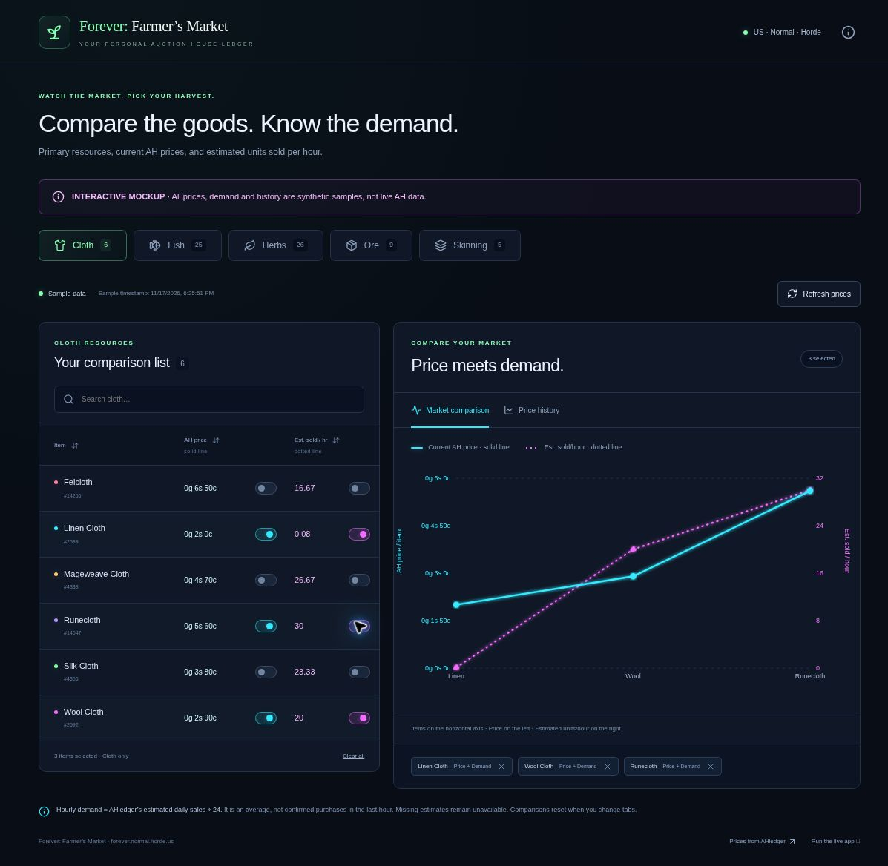

# Forever: Farmer’s Market

A personal, dark-mode auction dashboard for **WoW Forever · US / Americas · Normal PvE · Horde**, fixed to `forever.normal.horde.us`.

Current AH prices and average estimated units sold per hour, with same-tab comparisons of primary **Cloth, Fish, Herbs, Ore and Skinning** resources. Toggle price and demand beside each item to add or remove it from the shared graph. No account, addon, running game client or database is required.

## Interactive mockup

**[Open the interactive mockup](https://estabondotcom.github.io/Forever-Market-/mockup/)** · [Mockup files in this repository](mockup/)



The mockup runs directly in GitHub Pages on desktop and mobile. It uses the **same React dashboard component** as the live app, with clearly labeled synthetic sample prices, demand and history. It makes no AH API requests and requires no server or API key. It is a design/interaction preview, not a live market feed.

## Tabs and comparison controls

Tabs appear in this order: **Cloth, Fish, Herbs, Ore, Skinning**. The curated catalog has 71 directly farmed resources: 6 cloths, 25 fish, 26 herbs, 9 ores, and 5 leathers. Secondary catches, trophy/bloated fish, chests, potions, hides, gems, stones, Swiftthistle and Wildvine are excluded. Mageroyal and Raw Sagefish were verified and added. Rare standalone nodes/resources such as Black Lotus and Truesilver Ore remain as direct farming targets.

Every item row shows its **current lowest AH buyout** and **average estimated units sold per hour**, with an independent toggle beside each metric. Toggle several items on or off at once; use Clear all to reset the graph. Selections reset when changing tabs, and items from different tabs cannot share a comparison.

- **Market comparison:** items on the horizontal axis, solid cyan line for current AH price on the left axis, a dotted magenta line for estimated hourly demand on the right axis. Metrics retain their real units; they are never normalized onto one misleading scale. Missing values stay missing.
- **Price history:** solid neon lines compare the actual lowest-buyout histories of all enabled price toggles. Choose 24h, 7d or authorized 30d observations. Demand-only toggles do not invent a corresponding historical price series.
- Search/filter and sort the current section by resource name, AH price or hourly demand. The dark theme is permanent and the layout adapts for phones.

**Hourly demand = AHledger estimated units sold per day ÷ 24.** This is a daily average rate, not purchases measured during the last hour and not confirmed completed trades. Cancellations can resemble purchases. Historical demand is not supplied, so no purchase-volume history is invented. See [data provenance](docs/DATA-SOURCES.md).

All prices are per item in gold, silver and copper. Catalog identities were checked against Forever on 2026-11-17. The catalog is curated, not every game item.

## Windows launch — PowerShell

Install **Node.js 24 LTS** and Git, then run:

```powershell
git clone https://github.com/Estabondotcom/Forever-Market-.git
cd Forever-Market-
npm ci
Copy-Item .env.example .env.local
npm run dev
```

Open **http://localhost:3000**. No key is needed for current prices and seven-day history under documented free access. To use a different development port:

```powershell
npm run dev -- --port 3001
```

Production launch:

```powershell
npm run build
npm start
```

To open it on your phone over the same Wi-Fi, use `http://YOUR-PC-LAN-IP:3000`. For home-server access through Tailscale, use `http://YOUR-SERVER-TAILSCALE-IP:3000` with Tailscale connected on both devices.

## Environment variables

| Variable | Required | Purpose |
| --- | --- | --- |
| `AHLEDGER_API_KEY` | No | Server-only AHledger key, sent as `Authorization: Bearer ...`. Documented free key adds 30-day history after December 10, 2026. |
| `PORT` | No | Production port, default 3000; use `--port` for development. |
| `HTTP_PROXY`, `HTTPS_PROXY`, `NO_PROXY` | No | Standard system proxy configuration, normally unset on a home server. |
| `NEXT_TELEMETRY_DISABLED` | No | `1` disables Next.js telemetry; Docker already sets this. |

For local Node use, put the optional key in `.env.local`, then restart the server. Never use a `NEXT_PUBLIC_` variable for credentials. Secrets are excluded from Git and Docker build context. No key is required during builds or unit tests.

## Docker and CasaOS

CasaOS normally already provides Docker. In the server terminal:

```bash
cd /DATA/AppData
sudo git clone https://github.com/Estabondotcom/Forever-Market-.git wow-fishing
cd wow-fishing
sudo docker compose up -d --build
sudo docker compose ps
```

Open **http://YOUR-SERVER-IP:3000**. The existing Compose service name `fishing-tracker` and port are retained for compatibility. If port 3000 is occupied, change `3000:3000` to `3005:3000` in `compose.yaml` and use port 3005 in the browser.

For an optional API key in Docker, create `.env` beside `compose.yaml`:

```text
AHLEDGER_API_KEY=your_key_here
```

Apply it with `sudo docker compose up -d --force-recreate`. Never commit the file. The container runs as a non-root user and restarts after server reboots. No database or persistent market-cache volume is needed. Docker/CasaOS deployment has not been executed in this development environment.

Update an existing installation:

```bash
cd /DATA/AppData/wow-fishing
sudo git pull --ff-only
sudo docker compose up -d --build
```

Logs and stop commands:

```bash
sudo docker compose logs --tail=100 fishing-tracker
sudo docker compose down
```

## Checks and GitHub

```powershell
npm test
npm run typecheck
npm run build
npm run build:mockup
npm run verify:api
node --conditions=react-server --import tsx scripts/smoke-routes.ts
```

The deterministic unit tests cover currency, hourly demand, independent comparison switches, same-tab isolation, primary-resource filtering, multi-item historical alignment, missing/zero sales, parsing, auth failures, caching and expiry. Fixtures are synthetic. The live verification scripts make small read-only requests and save no provider responses. The route smoke check verifies all five categories and representative price histories.

GitHub Actions runs tests, type checking, production build, and regeneration of the committed mockup assets to catch preview drift. GitHub stores the code; **GitHub Pages cannot run the server API routes**. Run on CasaOS, locally, or a Next.js-compatible host.

The managed development environment blocks the preview server from binding its port. The published mockup passed desktop browser checks for multiple price/demand toggles, the combined graph, multi-item history, tab isolation and Clear all. A screenshot is committed above. Physical iPhone testing remains unverified. TypeScript, build, unit tests and real API routes are also checked.

## Freshness and terms

AHledger responses remain only in server/browser memory for their allowed Cache-Control lifetime. Expired data is removed and refreshed. The server coalesces duplicate requests, supports ETags when a reusable answer is available, and honors Retry-After. Manual refresh is throttled. A still-permitted response may be reused during an outage, but expired responses cannot become an indefinite offline snapshot. Refresh timing therefore follows the provider’s cache lifetime, often 60 seconds for the price table.

Latest actual auction observations are distinguished from fetch times. Missing sales or historical periods stay unavailable; estimated zero sales stays zero. Hourly demand divides the documented daily estimate by 24; missing estimates stay unavailable and zero stays zero. The demand line compares current estimates by item, not historical purchase counts.

## Structure

```text
src/app/             Page, fixed night theme, server API routes
src/components/      Market dashboard and solid/dotted line comparison charts
src/data/            Curated primary-resource catalog
src/lib/             Market comparisons, currency, parsers, adapter, cache, demo
src/hooks/           Bounded concurrent price-history fetching
preview/             Entry point for the same-component mockup
mockup/              Generated GitHub Pages preview (synthetic data)
scripts/             API verification and mockup build
tests/              Synthetic deterministic tests
docs/               Source validation and provider limitations
licenses/           Retained source attribution and copyright notices
Dockerfile
compose.yaml
```

## Attribution and license

Prices from [AHledger](https://ahledger.com), used under its [API terms](https://ahledger.com/developers). Personal noncommercial use requires attribution; monetization or data archival can require additional licensing. This source remains GPL v3; see `LICENSE`. Original CMaNGOS notices are retained for the catalog’s provenance. Blizzard names and item facts belong to their owners. No protected game artwork is used. Not affiliated with Blizzard or AHledger.

## Rebuilding the GitHub preview

```bash
npm run build:mockup
git add mockup
```

This bundles `preview/entry.tsx`, which renders `<Dashboard demoOnly />`, and copies the current dashboard CSS. Commit `mockup/index.html` and its generated assets together with source changes. GitHub Pages is configured for `main` at the repository root; the preview is served from `/Forever-Market-/mockup/`. GitHub Pages hosts the sample-data mockup, while the live Next.js application continues to run on your server.
