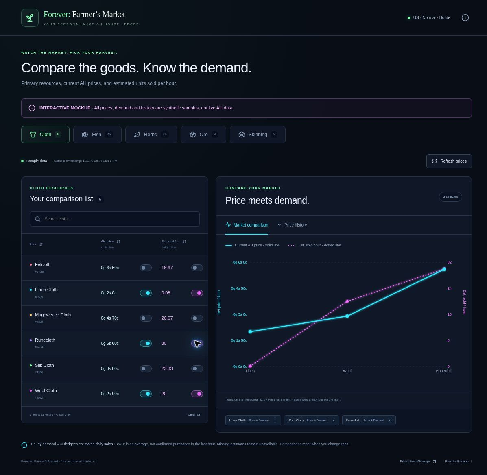

# Forever: Farmer’s Market — interactive mockup

**[Open the preview](https://estabondotcom.github.io/Forever-Market-/mockup/)**

- Uses the same React dashboard as the live application.
- All prices, demand and histories are **synthetic sample data**.
- Try Cloth, Fish, Herbs, Ore and Skinning.
- Toggle each item’s price and demand independently.
- Compare a dotted demand line and a solid price line.
- Open Price history to compare several selected price histories.
- Comparisons reset when changing tabs.

No server, API key or running WoW client is needed. This preview is not the live market feed.

Regenerate from the repository root with `npm run build:mockup`. Commit generated assets with source changes; CI checks they match.
